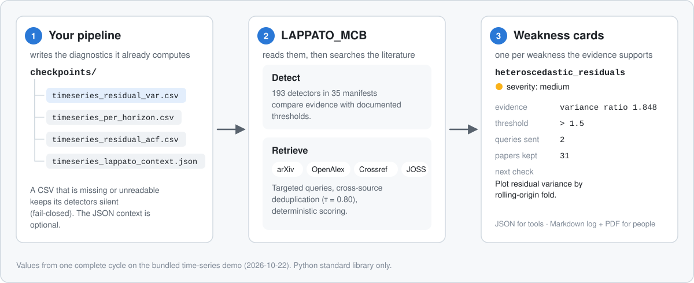
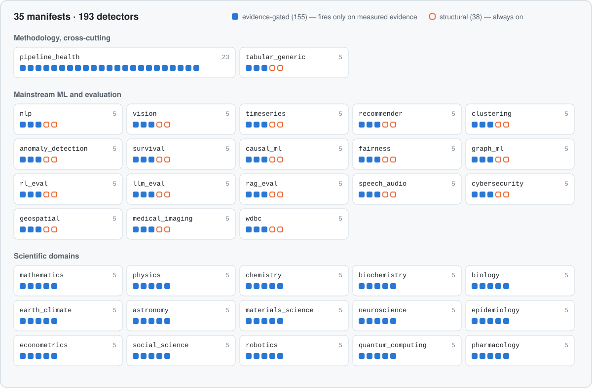
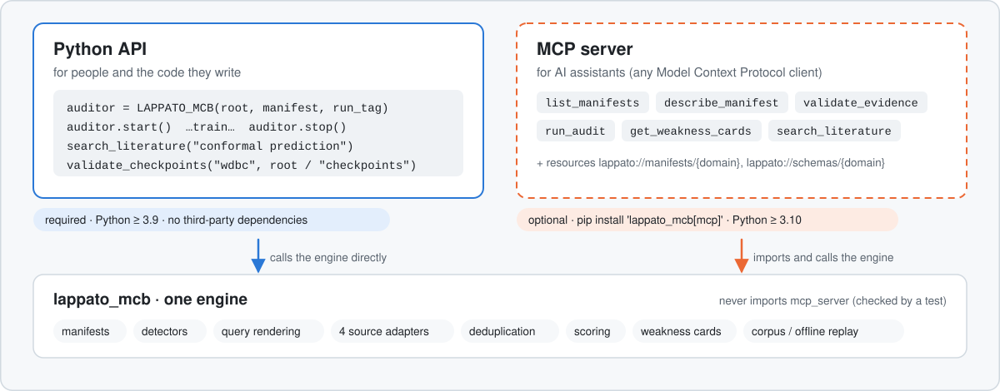
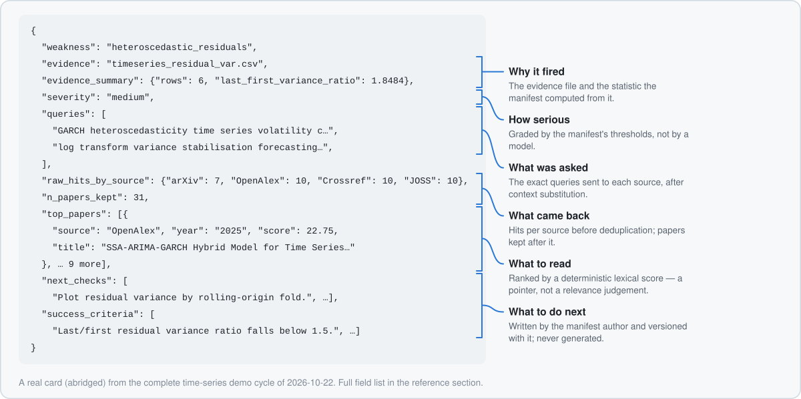
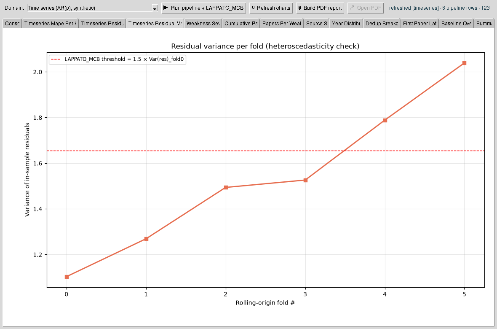
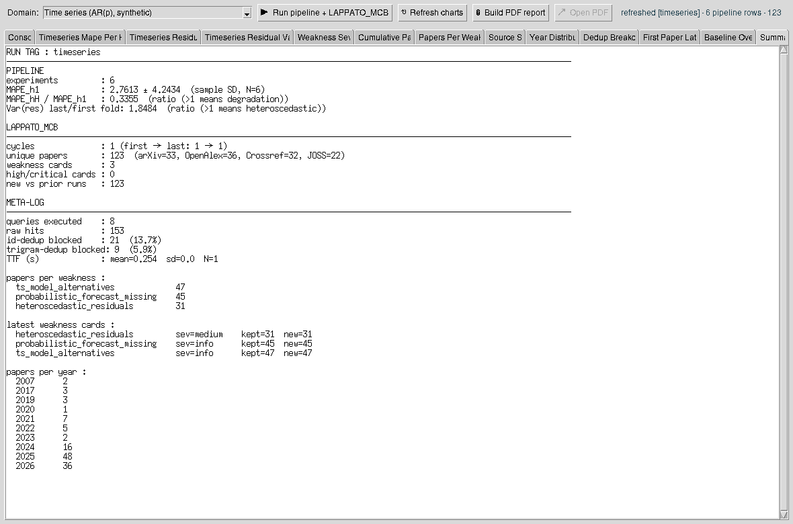
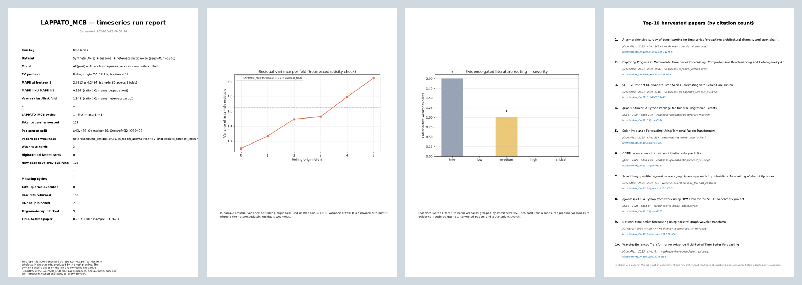
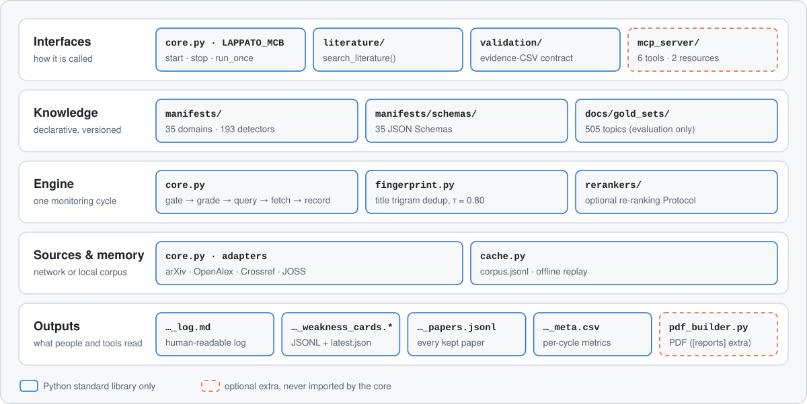
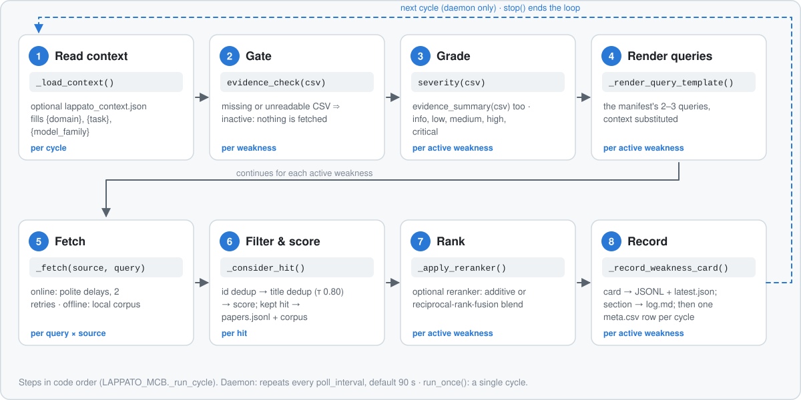
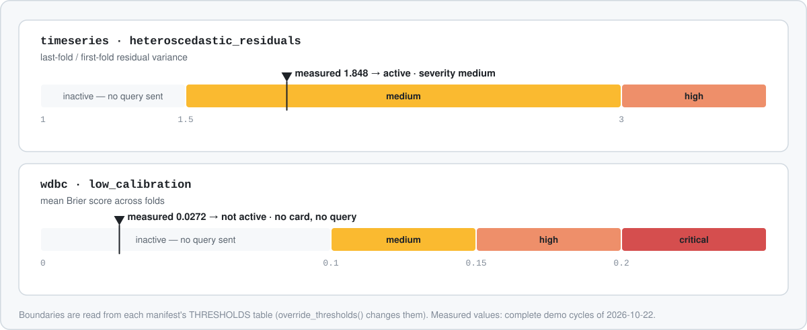

<a id="top"></a>

# LAPPATO_MCB

**Literature-Aware Pipeline Partner for Adaptive Transplant Optimization**

A Python library that reads the diagnostic files a machine-learning pipeline
already writes, flags methodological weaknesses when measured evidence crosses
a documented threshold, and retrieves scientific literature targeted at each
flagged weakness from arXiv, OpenAlex, Crossref and JOSS.

[](https://github.com/massimiliano-caretti/Lappato_MCB/actions/workflows/tests.yml)
[](pyproject.toml)
[](pyproject.toml)
[](LICENSE)
[](https://github.com/massimiliano-caretti/Lappato_MCB/releases)

<picture>
  <source media="(prefers-color-scheme: dark)" srcset="docs/figures/overview-dark.svg">
  
</picture>

<sub>Figure 1 — Every value in the figure comes from one complete cycle on the bundled
time-series demo (2026-10-22). Figures are generated from the code and from frozen
run data by <a href="docs/figures/build_figures.py"><code>docs/figures/build_figures.py</code></a>.</sub>

> [!IMPORTANT]
> **Research software.** LAPPATO_MCB applies fixed, documented heuristics and returns
> pointers to literature; it does not judge the quality of a model or of a paper.
> It is **not a medical device** and must not inform clinical, diagnostic or other
> high-stakes decisions, even though some bundled examples use clinical datasets.
> Read [Limitations](#11-limitations) and the full [Disclaimers](#13-disclaimers)
> before relying on any output.

## Contents

1. [What it does — and what it does not](#1-what-it-does--and-what-it-does-not)
2. [One library, two optional ways to drive it](#2-one-library-two-optional-ways-to-drive-it)
3. [Quick start](#3-quick-start)
4. [What the output looks like (real runs)](#4-what-the-output-looks-like-real-runs)
5. [How it works: anatomy and physiology](#5-how-it-works-anatomy-and-physiology)
6. [Manual](#6-manual)
7. [Use by people and by AI assistants](#7-use-by-people-and-by-ai-assistants)
8. [Modularity and scalability](#8-modularity-and-scalability)
9. [What has been measured](#9-what-has-been-measured)
10. [Relation to existing tools](#10-relation-to-existing-tools)
11. [Limitations](#11-limitations)
12. [Not yet implemented](#12-not-yet-implemented)
13. [Disclaimers](#13-disclaimers)
14. [Third-party software, data and trademarks](#14-third-party-software-data-and-trademarks)
15. [License, citation, author](#15-license-citation-author)

---

## 1. What it does — and what it does not

| It does | It does not |
| --- | --- |
| Read CSV files your pipeline writes to `checkpoints/` (per-fold metrics, calibration, residuals, class counts …). | Instrument, wrap or modify your model or training loop. |
| Evaluate **evidence-gated detectors**: each one fires only when its CSV exists and a statistic crosses a threshold written in the manifest. | Fire on missing or unreadable evidence (detectors are fail-closed). |
| Grade each active weakness (`info`, `low`, `medium`, `high`, `critical`) with the manifest's own rules. | Use a learned model, an LLM or any paid service to decide anything. |
| Send the manifest's queries to arXiv, OpenAlex, Crossref and (opt-in per detector) JOSS, then deduplicate across sources and score the hits. | Summarise, rank by meaning, or vouch for the papers it returns. |
| Write a human-readable log, a machine-readable **weakness card** per active weakness, a paper list and per-cycle metrics. | Apply the suggested changes for you. |
| Replay a past harvest offline from a local corpus, with no network access. | Guarantee the same online results on different days (the indices change). |

**Shipped coverage** (counted from the code, v1.7.0):

| | |
| --- | --- |
| Domain manifests | **35** |
| Detectors | **193** — 155 evidence-gated, 38 structural (always on) |
| Literature sources | arXiv, OpenAlex, Crossref, JOSS (via Crossref ISSN filter) |
| Runtime dependencies of the library | **none** (Python standard library, Python ≥ 3.9) |
| Optional extras | `[mcp]` MCP server · `[reports]` PDF/plots · `[examples]` demos · `[insights]` SciPy |

<details>
<summary><b>Coverage by domain</b> (figure)</summary>
<br>
<picture>
  <source media="(prefers-color-scheme: dark)" srcset="docs/figures/coverage-dark.svg">
  
</picture>
</details>

---

## 2. One library, two optional ways to drive it

<picture>
  <source media="(prefers-color-scheme: dark)" srcset="docs/figures/interfaces-dark.svg">
  
</picture>

- **Library (the product).** `import lappato_mcb` is all most users need. It has no
  third-party dependencies and runs on Python 3.9–3.13.
- **MCP server (optional adapter).** The same functions exposed as
  [Model Context Protocol](https://modelcontextprotocol.io) tools, so an AI
  assistant can call them. It is a separate sub-package, installed only with the
  `[mcp]` extra. The library never imports it — enforced by
  [`tests/mcp_server/test_config.py`](tests/mcp_server/test_config.py) — so not
  installing it changes nothing.

---

## 3. Quick start

```bash
pip install -e .                 # from a clone; the library alone
pip install -e ".[examples]"     # + NumPy, scikit-learn, LightGBM for the demos
```

**A. Alongside training** — a background thread polls `checkpoints/`:

```python
from pathlib import Path
from lappato_mcb import LAPPATO_MCB
from lappato_mcb.manifests import get as get_manifest

manifest, run_tag = get_manifest("pipeline_health")   # any of the 35 domains
auditor = LAPPATO_MCB(Path("."), manifest=manifest, run_tag=run_tag)

auditor.start()
# … your training / evaluation writes CSVs into ./checkpoints/ …
auditor.stop()
```

**B. After training** — one synchronous cycle (recommended for short runs):

```python
auditor = LAPPATO_MCB(Path("."), manifest=manifest, run_tag=run_tag)
auditor.run_once()
print(auditor.artefacts.cards_latest)   # checkpoints/pipeline_health_lappato_mcb_weakness_cards.latest.json
```

**C. From an AI assistant** (optional, Python ≥ 3.10):

```bash
pip install -e ".[mcp]"
claude mcp add lappato-mcb -- lappato-mcb-mcp --root /path/to/your/projects
```

**Try it end to end** with a bundled demo (needs network for the literature step):

```bash
python examples/demo_timeseries.py      # synthetic series, about 1 minute
```

> The detectors only fire when the pipeline writes the CSV files a manifest expects.
> Wiring `start()`/`stop()` takes two lines; emitting the evidence files is the
> real integration work — see [How-to: emit the evidence files](#how-to-emit-the-evidence-files).

---

## 4. What the output looks like (real runs)

Everything in this section was produced on 2026-10-22 by the bundled demos and one
complete `run_once()` cycle per demo; nothing is mocked.

### A weakness card

<picture>
  <source media="(prefers-color-scheme: dark)" srcset="docs/figures/weakness-card-dark.svg">
  
</picture>

### The optional desktop viewer

[`examples/gui.py`](examples/gui.py) is a small Tk application that runs a demo
and plots its outputs. It is a demonstration, not part of the library.



<sub>The evidence behind the active card: residual variance per fold crosses 1.5 × the variance of fold 0.</sub>

<details>
<summary>Summary tab of the same run</summary>
<br>

</details>

### The PDF report (`[reports]` extra)



<sub>Pages 1, 4, 5 and 13 of the 13-page report for the time-series demo, built with
<code>lappato_mcb.pdf_builder.build_pdf</code>.</sub>

### Other files written per run (`checkpoints/`)

| File | Content | Reader |
| --- | --- | --- |
| `<run_tag>_lappato_mcb_log.md` | One section per cycle and weakness: evidence, severity, papers, transplant sketch | people |
| `<run_tag>_lappato_mcb_weakness_cards.jsonl` | Append-only history of every card | tools, audits |
| `<run_tag>_lappato_mcb_weakness_cards.latest.json` | Latest card per weakness | tools, AI assistants |
| `<run_tag>_lappato_mcb_papers.jsonl` | Every kept paper, with the query that found it | tools |
| `<run_tag>_lappato_mcb_meta.csv` | One row of metrics per cycle (queries, hits, dedup, errors, timing) | self-evaluation |
| `corpus.jsonl` | All harvested papers across runs, for offline replay | the library |

---

## 5. How it works: anatomy and physiology

### Anatomy — what the parts are

<picture>
  <source media="(prefers-color-scheme: dark)" srcset="docs/figures/anatomy-dark.svg">
  
</picture>

A **manifest** is a plain Python list of weakness entries. The knowledge lives
there, not in the engine:

```python
{
    "id": "heteroscedastic_residuals",
    "title": "Residual variance grows across rolling-origin folds",
    "evidence": "timeseries_residual_var.csv",       # None ⇒ structural (always on)
    "evidence_check": _heteroscedastic_residuals,    # CSV path -> bool
    "evidence_summary": _residual_var_summary,       # CSV path -> dict shown in the card
    "severity": _residual_var_severity,              # CSV path -> "medium" | "high" | ...
    "queries": [
        "GARCH heteroscedasticity time series volatility clustering",
        "log transform variance stabilisation forecasting time series",
    ],
    "sources": ["arXiv", "OpenAlex", "Crossref", "JOSS"],
    "transplant": "Apply Box-Cox / log variance-stabilising transform; …",
    "next_checks": ["Plot residual variance by rolling-origin fold.", …],
    "success_criteria": ["Last/first residual variance ratio falls below 1.5.", …],
}
```

<sub>Abridged from <a href="lappato_mcb/manifests/timeseries.py"><code>lappato_mcb/manifests/timeseries.py</code></a>.
Thresholds live in each manifest's <code>THRESHOLDS</code> table, with the literature source of each value in a comment.</sub>

### Physiology — what happens in one cycle

<picture>
  <source media="(prefers-color-scheme: dark)" srcset="docs/figures/physiology-dark.svg">
  
</picture>

### How a detector decides

<picture>
  <source media="(prefers-color-scheme: dark)" srcset="docs/figures/gating-dark.svg">
  
</picture>

The second panel is the common case: a well-calibrated model produces no card and
no network traffic for that weakness.

### Is all of this actually implemented?

Each statement above maps to code you can read and to a test that exercises it.

| Statement | Code | Test |
| --- | --- | --- |
| Detectors are fail-closed | `LAPPATO_MCB._is_active` in [`core.py`](lappato_mcb/core.py) | [`test_lappato_mcb.py`](tests/test_lappato_mcb.py), [`test_insight_detectors.py`](tests/test_insight_detectors.py) |
| Thresholds are documented and overridable | `THRESHOLDS` + `override_thresholds()` in all 35 manifests | [`test_detector_thresholds.py`](tests/test_detector_thresholds.py) |
| Four sources, JOSS opt-in per detector | `_SOURCE_FN`, `_source_pipeline_for` in [`core.py`](lappato_mcb/core.py) | [`test_lappato_mcb.py`](tests/test_lappato_mcb.py) |
| Cross-source deduplication (τ = 0.80) | [`fingerprint.py`](lappato_mcb/fingerprint.py), `_consider_hit` | [`test_lappato_mcb.py`](tests/test_lappato_mcb.py) |
| Optional reranker, additive or RRF blend | `Reranker`, `_apply_reranker` in [`core.py`](lappato_mcb/core.py) | [`test_reranker_protocol.py`](tests/test_reranker_protocol.py), [`test_trigram_reranker.py`](tests/test_trigram_reranker.py) |
| Offline replay from a local corpus | [`cache.py`](lappato_mcb/cache.py) | [`test_lappato_mcb.py`](tests/test_lappato_mcb.py) |
| Evidence-CSV contract per manifest | [`validation/`](lappato_mcb/validation/), [`manifests/schemas/`](lappato_mcb/manifests/schemas/) | [`test_gold_sets.py`](tests/test_gold_sets.py), [`test_validation_api.py`](tests/test_validation_api.py) |
| Library never imports the MCP server | [`mcp_server/`](lappato_mcb/mcp_server/) | [`tests/mcp_server/test_config.py`](tests/mcp_server/test_config.py) |
| MCP paths confined to `--root` | [`mcp_server/sandbox.py`](lappato_mcb/mcp_server/sandbox.py) | [`tests/mcp_server/test_sandbox.py`](tests/mcp_server/test_sandbox.py) |

The test suite runs on Python 3.9–3.13 in CI: `pip install -e ".[dev]"` then `python -m pytest`.

---

## 6. Manual

The manual follows the [Diátaxis](https://diataxis.fr/) split: a tutorial to learn,
how-to guides for specific goals, a reference to look things up, and explanations
of the design. Reference sections are collapsed; click to expand.

### Tutorial: your first audit

1. **Install** the library and the demo dependencies: `pip install -e ".[examples]"`.
2. **Produce evidence.** `python examples/demo_wdbc.py` trains LightGBM on the WDBC
   dataset and writes `wdbc_per_fold.csv`, `wdbc_calibration.csv` and
   `wdbc_feature_importance.csv` to `checkpoints/`.
3. **Check the contract.** `python examples/validate_evidence_csv.py --domain wdbc`
   reports `[ OK ]` for each file whose columns match the schema.
4. **Run one complete cycle:**

   ```python
   from pathlib import Path
   from lappato_mcb import LAPPATO_MCB
   from lappato_mcb.manifests import get as get_manifest

   manifest, run_tag = get_manifest("wdbc")
   LAPPATO_MCB(Path("."), manifest=manifest, run_tag=run_tag).run_once()
   ```

5. **Read the result.** Open `checkpoints/wdbc_lappato_mcb_log.md`. In the run of
   2026-10-22 the model was well calibrated (mean Brier 0.0272 < 0.10), so the
   calibration detector stayed silent and only the two structural cards appeared.
   That is the expected behaviour, not a failure.

### How-to guides

<a id="how-to-emit-the-evidence-files"></a>
<details>
<summary><b>Emit the evidence files a manifest expects</b></summary>

Each manifest documents its files in `lappato_mcb/manifests/schemas/<domain>.schema.json`
(canonical column names, accepted aliases, which detectors read the file). Write them
with the standard library where your pipeline already computes the numbers:

```python
import csv
with open("checkpoints/wdbc_calibration.csv", "w", newline="") as fh:
    w = csv.DictWriter(fh, fieldnames=["fold", "brier"])
    w.writeheader()
    w.writerow({"fold": 0, "brier": 0.0367})
```

Then check them. The validator prints a ready-to-paste `csv.DictWriter` snippet for
every missing or incomplete file:

```bash
python examples/validate_evidence_csv.py --domain wdbc --checkpoints checkpoints/
```

Missing files are allowed (their detectors stay inactive); a present file that lacks
a required column makes the validator exit with status 1, so it can gate CI.
</details>

<details>
<summary><b>Choose a manifest</b></summary>

```python
from lappato_mcb import manifests
sorted(manifests.REGISTRY)                 # the 35 domain ids
manifest, run_tag = manifests.get("nlp")   # KeyError lists valid ids on a typo
```

`pipeline_health` (23 detectors) is domain-agnostic: class imbalance, cross-seed
variance, train/test overlap, label noise, subgroup disparity, calibration gaps,
threshold choice, drift across cycles, and more. Start there when no domain manifest fits.
</details>

<details>
<summary><b>Make queries specific to your run</b></summary>

Write `checkpoints/lappato_context.json` (or `<run_tag>_lappato_context.json`):

```json
{"domain": "clinical tabular", "task": "binary classification",
 "model_family": "LightGBM", "dataset": "Wisconsin Breast Cancer Diagnostic"}
```

Manifest queries may contain `{domain}`, `{task}`, `{model_family}`; missing keys are dropped.
**Everything in this file is sent to the literature services as query text** — do not put
confidential information in it.
</details>

<details>
<summary><b>Run without network (offline replay)</b></summary>

Every online run appends what it harvests to `checkpoints/corpus.jsonl`. Later runs can search
that corpus instead of the network:

```python
LAPPATO_MCB(Path("."), manifest=manifest, run_tag=run_tag, offline=True).run_once()
```

With the same corpus and the same evidence, offline runs give the same output: the code path
contains no randomness.
</details>

<details>
<summary><b>Tune or override thresholds</b></summary>

```python
from lappato_mcb.manifests import wdbc
wdbc.THRESHOLDS["brier_warning"]          # 0.10
wdbc.override_thresholds({"brier_warning": 0.12})
```

The defaults carry a citation in the manifest source. Changing them changes what fires;
record the values you used when you report results.
</details>

<details>
<summary><b>Add a reranker</b></summary>

```python
from lappato_mcb.rerankers.trigram import TrigramJaccardReranker
LAPPATO_MCB(Path("."), manifest=manifest, run_tag=run_tag,
            reranker=TrigramJaccardReranker(), blend_mode="rrf", reranker_weight=2.0)
```

Any object with a deterministic `score(query, hits) -> list[float]` satisfies the `Reranker`
Protocol. A reranker that raises is skipped and the lexical order is kept. When configured,
every card records the blend mode, weight and the reranker's `model_name`/`model_version`/`model_sha`.
See [Reranker benchmark](docs/reranker_benchmark_phase05.md) for why `"rrf"` is recommended over
`"additive"` (measured on synthetic fixtures only).
</details>

<details>
<summary><b>Write your own manifest</b></summary>

1. Create `lappato_mcb/manifests/<domain>.py` exporting `MANIFEST`, `RUN_TAG`, `THRESHOLDS`,
   `override_thresholds` (copy [`wdbc.py`](lappato_mcb/manifests/wdbc.py) as a template).
2. Register it in `REGISTRY` in [`manifests/__init__.py`](lappato_mcb/manifests/__init__.py).
3. Add `manifests/schemas/<domain>.schema.json` and `docs/gold_sets/<domain>_gold.json`;
   the test suite requires both for every registered domain.
4. If you regenerate the README figures, assign the domain to a family in
   [`build_figures.py`](docs/figures/build_figures.py) (the script refuses to run otherwise).

The contract for proposals is in [`.github/ISSUE_TEMPLATE/new_manifest.md`](.github/ISSUE_TEMPLATE/new_manifest.md).
</details>

<details>
<summary><b>Search the literature without a manifest</b></summary>

```python
from lappato_mcb.literature import search_literature
out = search_literature("conformal prediction time series",
                        sources=["arXiv", "OpenAlex"], max_results=5)
out["hits"]     # each hit carries a "source" key
out["errors"]   # {"OpenAlex": "TimeoutError: …"} if a source failed; the others still answer
```
</details>

<details>
<summary><b>Build the PDF report</b></summary>

```python
from pathlib import Path
from lappato_mcb import analysis, pdf_builder        # needs the [reports] extra
bundle = analysis.load_all(Path("checkpoints"), run_tag="timeseries")
pdf_builder.build_pdf(bundle, Path("checkpoints/timeseries_report.pdf"))
```
</details>

<details>
<summary><b>Connect an AI assistant (MCP)</b></summary>

```bash
pip install -e ".[mcp]"                                   # Python ≥ 3.10
claude mcp add lappato-mcb -- lappato-mcb-mcp --root /path/to/projects
```

Any MCP client that launches stdio servers works the same way; for clients configured by
JSON, use `"command": "lappato-mcb-mcp", "args": ["--root", "/path/to/projects"]`.
Full reference: [`docs/mcp_server.md`](docs/mcp_server.md).
</details>

### Reference

<details>
<summary><b><code>LAPPATO_MCB(project_root, manifest=None, run_tag="wdbc", poll_interval=90.0, *, …)</code></b></summary>

| Parameter | Default | Meaning |
| --- | --- | --- |
| `project_root` | — | Folder containing `checkpoints/` (created if needed) |
| `manifest` | WDBC manifest | List of weakness entries, usually from `manifests.get()` |
| `run_tag` | `"wdbc"` | Prefix of every output file; lets domains share one folder |
| `poll_interval` | `90.0` | Seconds between daemon cycles |
| `offline` | `False` | Search `corpus.jsonl` instead of the network |
| `corpus_path` | `checkpoints/corpus.jsonl` | Corpus file to read and append |
| `fp_tau` | `0.80` | Jaccard threshold for title deduplication |
| `score_weights` | `DEFAULT_SCORE_WEIGHTS` | `ScoreWeights(title_overlap=4.0, abstract_overlap=1.5, recency_per_year=0.25, recency_max_years=4, recency_base_year=2022, citation_log_weight=0.15)` |
| `http_max_retries` | `2` | Retries per request (exponential back-off from 1 s) |
| `reranker` | `None` | Object implementing the `Reranker` Protocol |
| `reranker_weight` / `reranker_floor` | `0.5` / `0.30` | Blend parameters |
| `blend_mode` | `"additive"` | `"additive"` or `"rrf"` (reciprocal rank fusion, k = 60) |

| Member | Behaviour |
| --- | --- |
| `start()` / `stop(timeout=10.0)` / `is_running()` | Daemon thread lifecycle. `stop()` interrupts a cycle in progress. |
| `run_once()` | One synchronous cycle on the current evidence. |
| `artefacts` | `RunArtefacts` with the paths of `log`, `papers_jsonl`, `meta_log`, `cards_jsonl`, `cards_latest`. |
</details>

<details>
<summary><b>Other public functions and classes</b></summary>

| Name | Purpose |
| --- | --- |
| `lappato_mcb.manifests.get(domain)` / `REGISTRY` | `(manifest, run_tag)` lookup; all domains |
| `lappato_mcb.manifests.naive_baseline_manifest(run_tag)` | One-query baseline for comparisons |
| `lappato_mcb.RunArtefacts.for_project(root, run_tag)` | Output paths without starting anything |
| `lappato_mcb.literature.search_literature(query, *, sources, max_results, offline, corpus_path)` | Ad-hoc search |
| `lappato_mcb.validation.validate_checkpoints(domain, folder)` / `render_report(report)` | Evidence-CSV checks |
| `lappato_mcb.validation.load_schema(domain)` / `list_schema_domains()` | Schemas |
| `lappato_mcb.cache.CorpusCache(path)` · `.search(query, k)` · `.stats` | Local corpus |
| `lappato_mcb.cache.merge_jsonl_into_corpus(paths, corpus)` | Build a corpus from past paper files |
| `lappato_mcb.rerankers.trigram.TrigramJaccardReranker` | Standard-library reranker baseline |
| `lappato_mcb.analysis.load_all` · `plots.build_all` · `pdf_builder.build_pdf` | Reports (`[reports]` extra) |
</details>

<details>
<summary><b>Weakness card fields</b></summary>

`ts`, `cycle`, `run_tag`, `weakness`, `title`, `evidence`, `evidence_present`, `severity`,
`previous_severity`, `severity_changed`, `evidence_summary`, `queries`, `raw_hits_by_source`,
`n_raw_hits`, `n_papers_kept`, `n_new_vs_previous_runs`, `n_seen_before`,
`top_papers[]` (`source`, `id`, `title`, `year`, `url`, `score`), `why_it_matters`,
`next_checks`, `success_criteria`, `references`, `transplant`; plus a `reranker` block
when a reranker is configured.
</details>

<details>
<summary><b>Meta-log columns</b> (<code>&lt;run_tag&gt;_lappato_mcb_meta.csv</code>)</summary>

`cycle`, `ts_started_iso`, `wall_seconds`, `n_active_weaknesses`, `n_queries_executed`,
`n_{arxiv,openalex,crossref,joss}_hits_raw`, `n_{arxiv,openalex,crossref,joss}_errors`,
`n_id_dedup_blocked`, `n_fp_dedup_blocked`, `n_papers_kept`, `first_paper_seconds`.
</details>

<details>
<summary><b>MCP tools and resources</b></summary>

| Tool | Arguments | Result | Writes |
| --- | --- | --- | --- |
| `list_manifests` | — | domains, run tags, detector counts | no |
| `describe_manifest` | `domain` | detectors, evidence files, queries, guidance, schema | no |
| `validate_evidence` | `domain`, `project_root` | per-file report + `csv.DictWriter` snippets | no |
| `run_audit` | `domain`, `project_root`, `offline` | the cards of this cycle | `checkpoints/` |
| `get_weakness_cards` | `domain`, `project_root` | latest card per weakness | no |
| `search_literature` | `query`, `sources`, `max_results`, `offline`, `project_root` | hits + per-source errors | no |

Resources: `lappato://manifests/{domain}`, `lappato://schemas/{domain}`. Audits are offline unless
the client passes `offline=false` or the server runs with `--online`. Details:
[`docs/mcp_server.md`](docs/mcp_server.md).
</details>

<details>
<summary><b>Command line and environment</b></summary>

| Command / variable | Purpose |
| --- | --- |
| `lappato-mcb-mcp [--root DIR] [--online]` | Start the MCP server (stdio) |
| `python examples/validate_evidence_csv.py --domain D [--checkpoints DIR] [--csv FILE] [--no-suggest]` | Validate evidence files |
| `python examples/measure_recall.py --domain D --checkpoints DIR` | Topic recall of a harvest against the gold sets |
| `python examples/validate_score.py --min-spearman 0.70` | Regression check of the local relevance score |
| `LAPPATO_MCB_MAILTO` | Contact e-mail sent in the User-Agent of every request and as the `mailto` parameter to OpenAlex and Crossref |
| `LAPPATO_MCB_MCP_ROOT`, `LAPPATO_MCB_MCP_ONLINE` | MCP server defaults (flags take precedence) |
</details>

### Explanation: design choices

- **Evidence first.** A detector reads a number your pipeline measured; it does not guess.
  Structural detectors (38) are the exception and are labelled `info`: they raise a design
  question (for example "is there a probabilistic forecast?") on every run.
- **Standard library only.** The core can be dropped into any environment without
  dependency conflicts; optional features sit behind extras.
- **Auditable knowledge.** Detectors, thresholds and queries are versioned Python and JSON,
  reviewable in a diff, not learned weights or prompts.
- **Determinism where it is possible.** Query rendering, deduplication, scoring and offline
  search are deterministic. Online results depend on the indices on the day of the run.

---

## 7. Use by people and by AI assistants

| | People | AI assistants |
| --- | --- | --- |
| Entry point | Python API, demo GUI, PDF report | MCP tools, or the JSON files |
| Reads | `…_log.md`, PDF | `…_weakness_cards.latest.json`, `describe_manifest` |
| Typical action | Read the cited papers, decide | Implement a `next_check` in the user's code, emit a missing CSV |
| Safeguards | — | Paths confined to `--root`; offline by default; the assistant's changes still need human review |

A card gives an assistant a specific brief — the weakness, the evidence, the severity, the
literature, the next checks and the success criteria — instead of a generic request such as
"improve my model". Example prompt for an editor chat:

```text
Use this LAPPATO_MCB weakness card as context. Implement its first next_check in my
pipeline, write the result as a CSV under checkpoints/, and do not change existing
model or evaluation logic.
[paste the card JSON]
```

---

## 8. Modularity and scalability

**Modularity — what you can extend, and how much code it touches** (verified in the current code):

| Extension | Where | Files to change |
| --- | --- | --- |
| New domain | `lappato_mcb/manifests/` | 1 module + 1 registry line (+ schema and gold set, required by tests) |
| New literature source | `core.py` | 1 search function + 1 entry in `_SOURCE_FN` and `_SOURCE_PIPELINE`; the meta-log has one column per named source, so a new source is not counted there until a column is added |
| New ranking method | any module | 1 class implementing `Reranker` — no core change |
| New MCP tool | `mcp_server/tools/` | 1 module + 1 entry in `TOOL_MODULES` |
| New report for a domain | `lappato_mcb/reports/` | 1 report pack |

**Scalability — what the code does today, with numbers:**

- **Work per cycle** grows with the number of *active* weaknesses × queries (2–3 each) ×
  sources (3–4). Requests are **sequential** on one thread, with polite delays of 3 s after
  each arXiv request and 0.25 s after OpenAlex and Crossref.
- **Measured:** complete online cycles took **48–61 s** for 2–4 active weaknesses (6–8 queries,
  three demos, 2026-10-22). Inactive weaknesses cost nothing.
- **Offline search** scans the whole corpus for each query (linear time, no index). The corpus
  and the JSONL files are append-only and are never rotated.
- **Detector evaluation** reads small CSVs; its cost is negligible next to network time.
- The design target is one pipeline per process. There is no distributed mode, no shared
  server state, no parallel fetching.

---

## 9. What has been measured

| Measurement | Result | Scope |
| --- | --- | --- |
| Local relevance score vs. a hand-rated set (`validate_score.py`) | Spearman **+0.891** | Small maintainer-rated set; regression check, CI floor 0.70 |
| Topic recall of real harvests, 2026-10-22 (`measure_recall.py`) | **22 of 25** gold topics found (WDBC 6/7, time series 9/11, NLP 7/7) | Weaknesses that fired only; gold topics curated by the author; keyword match |
| Recall on a synthetic corpus (`measure_recall_synthetic.py`) | 1.000 on all 35 domains | Easy by construction — checks plumbing, not quality |
| Reranker micro-benchmark | Recall@5 0.490 → 0.830 with `rrf` (w = 2) | Synthetic hard fixtures; [details](docs/reranker_benchmark_phase05.md) |

**Not measured:** retrieval quality against an external gold standard, and whether using
LAPPATO_MCB improves real pipelines. See [Not yet implemented](#12-not-yet-implemented).

---

## 10. Relation to existing tools

LAPPATO_MCB combines properties found separately in other tools; no single component is
new. The comparison is a design-level audit of what each family is built to do, not a
performance benchmark. ✓ by design · ~ partial or deployment-dependent · – absent.

| Property | Literature search¹ | Experiment trackers² | LLM research agents³ | LAPPATO_MCB |
| --- | :-: | :-: | :-: | :-: |
| Runs alongside training | – | ✓ | – | ✓ |
| Activation gated on measured evidence | – | – | – | ✓ |
| Deterministic for the same inputs and source state | ~ | ✓ | – | ✓ |
| Core without third-party packages | – | – | – | ✓ |
| Three or more scholarly sources in one run | ~ | – | ~ | ✓ |
| Deduplication across sources | – | – | – | ✓ |
| Works offline | – | ~ | – | ✓ |
| No paid service required | ~ | ~ | – | ✓ |
| Rules readable in version control | – | – | – | ✓ |

<sub>¹ Elicit, Connected Papers, Semantic Scholar, Research Rabbit. ² MLflow, Weights & Biases, TensorBoard.
³ Agent Laboratory, AI-Researcher. Assessment of design and documentation by the author, not a benchmark.</sub>

Use an experiment tracker to record runs, a literature tool to explore a field, and
LAPPATO_MCB to connect a measured weakness of one run to literature about that weakness.
It is **not** the right tool if you need paper summaries, semantic search, or automated fixes.

<details>
<summary>References for this comparison</summary>

- Schmidgall, S. et al. *Agent Laboratory: Using LLM Agents as Research Assistants.* arXiv:2501.04227 (2025).
- HKUDS. *AI-Researcher.* <https://github.com/HKUDS/AI-Researcher>
- Priem, J., Piwowar, H., Orr, R. *OpenAlex: A fully-open index of scholarly works, authors, venues, institutions, and concepts.* arXiv:2205.01833 (2022).
- *Monitoring Machine Learning Systems: A Multivocal Literature Review.* arXiv:2509.14294 (2025).
- *Towards Scientific Intelligence: A Survey of LLM-based Scientific Agents.* arXiv:2503.24047 (2025).
- Cormack, G. V., Clarke, C. L. A., Büttcher, S. *Reciprocal rank fusion outperforms Condorcet and individual rank learning methods.* SIGIR 2009.
- MLflow <https://mlflow.org/docs/> · Semantic Scholar API <https://www.semanticscholar.org/product/api> · Connected Papers <https://www.connectedpapers.com/> · Elicit <https://elicit.com/>
</details>

---

## 11. Limitations

- **Lexical, not semantic.** Queries and scores use words, not meaning. Papers with different
  vocabulary are missed, and off-topic papers can rank high: in the 2026-10-22 NLP run the
  top hit for *text-classifier calibration* was a paper on magnetic-tweezer force calibration.
- **Thresholds are generic.** Defaults come from the cited literature, not from your data. A
  detector that does not fire is not evidence that the weakness is absent.
- **Manifests are written by people.** Output quality depends on how well a manifest's
  checks and queries match your pipeline; the framework checks structure, not correctness.
- **Recency filters.** OpenAlex queries keep works published after 2023, Crossref queries works
  from 2024, the JOSS channel works from 2020; arXiv has no date filter. Older foundational work
  is therefore reached mainly through arXiv.
- **Results change over time.** arXiv, OpenAlex and Crossref add and re-rank records daily;
  only offline replay is reproducible.
- **Short runs.** `stop()` interrupts a cycle in progress. The bundled demos stop the daemon
  when training ends, which on 2026-10-22 left part of their harvest incomplete; use
  `run_once()` after training for a complete cycle. A daemon may also read a CSV while the
  pipeline is still writing it, and act on the partial content.
- **Service changes.** The code follows the 2025 etiquette of the sources (contact e-mail,
  polite delays). OpenAlex changed its access rules in 2026 (API keys, quotas); the library
  has no API-key support yet, so heavy use may be rate-limited.

---

## 12. Not yet implemented

Listed so that nobody mistakes them for features.

| Item | Status |
| --- | --- |
| Online retrieval benchmark against an external gold standard | Not started — the open empirical question |
| Study of effect on real pipelines (more than one deployment) | Not started |
| Semantic (embedding) reranker as an `[embed]` extra | Deferred until users report retrieval failures the trigram reranker cannot fix |
| OpenAlex API-key support | Not implemented |
| HTTPS for the arXiv endpoint (the code calls `http://export.arxiv.org`) | Not implemented |
| Parallel fetching, corpus index, log rotation | Not implemented (see [Scalability](#8-modularity-and-scalability)) |
| MCP: HTTP transport, progress notifications for long audits | Only stdio, no progress events |
| Archival DOI (Zenodo) | Not yet assigned; `CITATION.cff` has a placeholder |
| English version of the reranker benchmark report | The report is in Italian |
| Reorganisation of `examples/` into demos and benchmarks | Planned |

---

## 13. Disclaimers

- **No warranty.** The software is provided "as is", without warranty of any kind, as stated
  in the [MIT License](LICENSE). The author is not liable for any claim, damage or other
  liability arising from its use.
- **Not medical, clinical or professional advice.** LAPPATO_MCB is not a medical device and has
  not been validated for any clinical, diagnostic, regulatory, financial, legal or safety-critical
  use. Examples that use clinical datasets (such as WDBC) demonstrate software behaviour only.
- **Heuristics, not verdicts.** Detector outputs and severities are rule-based heuristics. A card
  is a prompt to investigate; the absence of a card is not proof that a pipeline is sound.
- **No endorsement of retrieved works.** Papers are selected automatically and may be irrelevant,
  outdated, low-quality or retracted. Their listing is not an endorsement; read and assess the
  primary sources yourself. Retrieved titles and abstracts remain the property of their copyright holders.
- **Third-party services.** Online use sends queries — derived from manifests and from your
  `lappato_context.json` — to arXiv, OpenAlex and Crossref, and your contact e-mail if you set
  `LAPPATO_MCB_MAILTO`. You are responsible for complying with each service's terms and rate
  limits, and for not sending confidential information. Availability of these services is not guaranteed.
- **AI assistants.** When driven through MCP, actions are chosen by an AI model. The server confines
  file access to `--root` and defaults to offline mode, but you remain responsible for reviewing
  any change an assistant makes to your code or data.
- **Independence.** This is an independent project. It is not affiliated with, sponsored by or
  endorsed by any organisation named in this document. Views and code are the author's own.

---

## 14. Third-party software, data and trademarks

**Software.** The library has no runtime dependencies and redistributes no third-party code.
Optional extras install packages under their own licenses, all permissive and compatible with MIT:

| Extra | Packages | Licenses |
| --- | --- | --- |
| `[examples]` | NumPy, scikit-learn, LightGBM | BSD-3-Clause (NumPy also bundles other permissive terms), BSD-3-Clause, MIT |
| `[reports]` | matplotlib | Matplotlib License (PSF-based) |
| `[insights]` | SciPy | BSD-3-Clause |
| `[mcp]` | `mcp` (Model Context Protocol Python SDK) and its dependencies | MIT; dependencies MIT, BSD, Apache-2.0, PSF; `certifi` MPL-2.0 (unmodified) |
| `[dev]` | pytest, build | MIT |

**Data sources** queried at runtime:

| Source | Terms |
| --- | --- |
| [arXiv API](https://info.arxiv.org/help/api/tou.html) | Metadata, including abstracts, under CC0 1.0; at most one request every 3 s (the code waits 3 s). *Thank you to arXiv for use of its open access interoperability.* |
| [OpenAlex](https://openalex.org/about) | Data under CC0. Cite Priem, Piwowar & Orr (2022). Access rules changed in 2026. |
| [Crossref REST API](https://www.crossref.org/documentation/retrieve-metadata/rest-api/) | Metadata reusable for any purpose; some abstracts may be copyrighted by publishers or authors. |
| [JOSS](https://joss.theoj.org/about) | Reached through Crossref metadata; papers are CC BY 4.0. |

**Example datasets** (downloaded or loaded at runtime, not stored in this repository):

- *Breast Cancer Wisconsin (Diagnostic)* — Wolberg, W., Mangasarian, O., Street, N., Street, W. (1993),
  UCI Machine Learning Repository, <https://doi.org/10.24432/C5DW2B>, CC BY 4.0, as shipped with scikit-learn.
- *20 Newsgroups* — fetched by scikit-learn at runtime; no license is stated by its original distributor.
- The time-series demo uses synthetic data.

**Versioned samples.** `docs/sample_outputs/` and `docs/figures/data/` keep titles, identifiers and
URLs of retrieved records; abstracts are kept only for arXiv records (CC0).

**Trademarks.** arXiv is a registered trademark of Cornell University. OpenAlex, Crossref, the Journal
of Open Source Software, Python, GitHub, Model Context Protocol, Claude, Claude Code, Visual Studio Code,
Cursor, JetBrains, ChatGPT, Gemini, MLflow, Weights & Biases, TensorBoard, LightGBM, scikit-learn and all
other names are trademarks or registered trademarks of their respective owners, used here only to identify
products and services. Their use implies no affiliation or endorsement.

---

## 15. License, citation, author

**License.** [MIT](LICENSE) © 2026 Massimiliano Caretti.

**Citation.** Please cite the software using [`CITATION.cff`](CITATION.cff) (GitHub shows a
"Cite this repository" button), or:

```bibtex
@software{caretti_lappato_mcb,
  author  = {Caretti, Massimiliano},
  title   = {{LAPPATO\_MCB}: Literature-Aware Pipeline Partner for Adaptive Transplant Optimization},
  version = {1.7.0},
  year    = {2026},
  url     = {https://github.com/massimiliano-caretti/Lappato_MCB},
  license = {MIT}
}
```

**Contributing.** See [`CONTRIBUTING.md`](CONTRIBUTING.md); issues and proposals for new manifests are
welcome through the [issue templates](.github/ISSUE_TEMPLATE/).

**Author.** Massimiliano Caretti — massimiliano.caretti@gmail.com

<sub><a href="#top">Back to top</a></sub>
